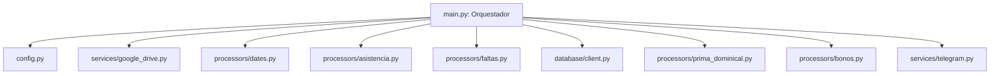

# Especificación Técnica de Arquitectura (Spec-Driven Architecture)

## 1. Visión General y Principios
La arquitectura se basa en el principio de separación de responsabilidades (**Separation of Concerns**) y modularidad desacoplada. El archivo de entrada `main.py` actúa estrictamente como **orquestador de pipeline**, delegando la configuración, las comunicaciones externas y la lógica matemática de nómina a paquetes especializados.

---

## 2. Definición de Módulos e Interfaces

### 2.1 `src/config.py`
Proporciona todas las configuraciones estáticas y rutas dinámicas.
- **Constantes:** `TELEGRAM_TOKEN`, `TELEGRAM_CHAT_ID`, `SHEET_ID`, `GIDS` (`principal`, `vtas`, `cyber`, `wincall`), `DB_CONFIG`.
- **Rutas:** Directorios `workspace`, `semana`, `temp`, y archivo `credentials.json`.
- **Catálogos:** Códigos de asistencia, nombres de días, nombres de meses.

### 2.2 `src/services/google_drive.py`
Maneja la autenticación segura con Service Account y descargas robustas ante límites de cuota HTTP 429.
- `get_drive_headers(creds_path, scopes) -> dict`
- `download_with_retry(url, headers, output_path, max_retries=3) -> bool`
- `download_sheet_by_gid(sheet_id, gid, headers, output_path) -> bool`

### 2.3 `src/services/telegram.py`
Envío de alertas y documentos a canales de Telegram.
- `send_telegram_reports(token, chat_id, summary_text, file_paths: dict) -> bool`

### 2.4 `src/database/client.py`
Capa de conexión MySQL a CyberHub.
- `conectar_bd(db_config) -> mysql.connector.connection`
- `extraer_empleados(conn) -> pd.DataFrame`
- `extraer_percepciones_deducciones(conn) -> pd.DataFrame`
- `generar_trabajadores(df_empleados, output_path) -> None`

### 2.5 `src/processors/dates.py`
Manejo y cálculo de fechas operativas.
- `extraer_fechas_semana(output_atn_raw) -> (list[str], datetime, str)`
  - Retorna `(expected_dates_dmy, reported_monday, semana_str)`.

### 2.6 `src/processors/asistencia.py`
Procesamiento de hojas de supervisores y ventas.
- `formatear_ventas(output_vtas, reported_monday) -> None`
- `procesar_nomina_principal(output_principal, expected_dates_dmy) -> (list, list[str])`
  - Inyecta fórmulas `=COUNTIF(...)`, suma total `=SUM(...)`, estilos y colores.
  - Retorna `(agents_records, corrections_made)`.

### 2.7 `src/processors/faltas.py`
Extracción y formato de incidencias y faltas.
- `extraer_faltas_concentrado(path_concentrado, expected_dates_dmy) -> list[dict]`
  - Aplica regla de códigos de ausencia y regla de 3 retardos.
- `guardar_y_estilizar_faltas(df, output_path) -> None`

### 2.8 `src/processors/prima_dominical.py`
Cálculo de prima dominical (P19).
- `generar_prima_dominical(df_empleados, expected_dates_dmy, output_cyber, output_wincall, path_cyber_conc, path_wincall_conc) -> None`

### 2.9 `src/processors/bonos.py`
Extracción de bonos autorizados de asistencia (P15 y P16).
- `extraer_bonos_concentrado(path_concentrado, col_name, expected_dates_dmy) -> pd.DataFrame`

---

## 3. Pipeline de Orquestación (`src/main.py`)
El flujo se ejecuta secuencialmente:
1. **Inicialización:** Crear carpetas `semana/` y `temp/`, obtener headers de Google Auth.
2. **Descarga Base:** Descargar nómina principal y concentrados.
3. **Fechas:** Extraer vector de 7 fechas desde celda I1.
4. **Formateo Ventas:** Inyectar fechas estáticas en `IZZI VTAS CONCENTRADO`.
5. **Asistencia Principal:** Calcular fórmulas y totales en `NOMINA POR SUPERVISOR IZZI ATN`.
6. **Incidencias:** Procesar Faltas CyberIdeas y WinCall.
7. **Prima Dominical:** Extraer sueldos diarios de MySQL y generar P19 para agentes que asistieron el domingo.
8. **Bonos:** Generar archivos de P15 y P16 para agentes autorizados.
9. **Distribución:** Armar reporte HTML y enviar archivos adjuntos a Telegram.
10. **Métricas:** Imprimir resumen en consola y retornar códigos de salida.
